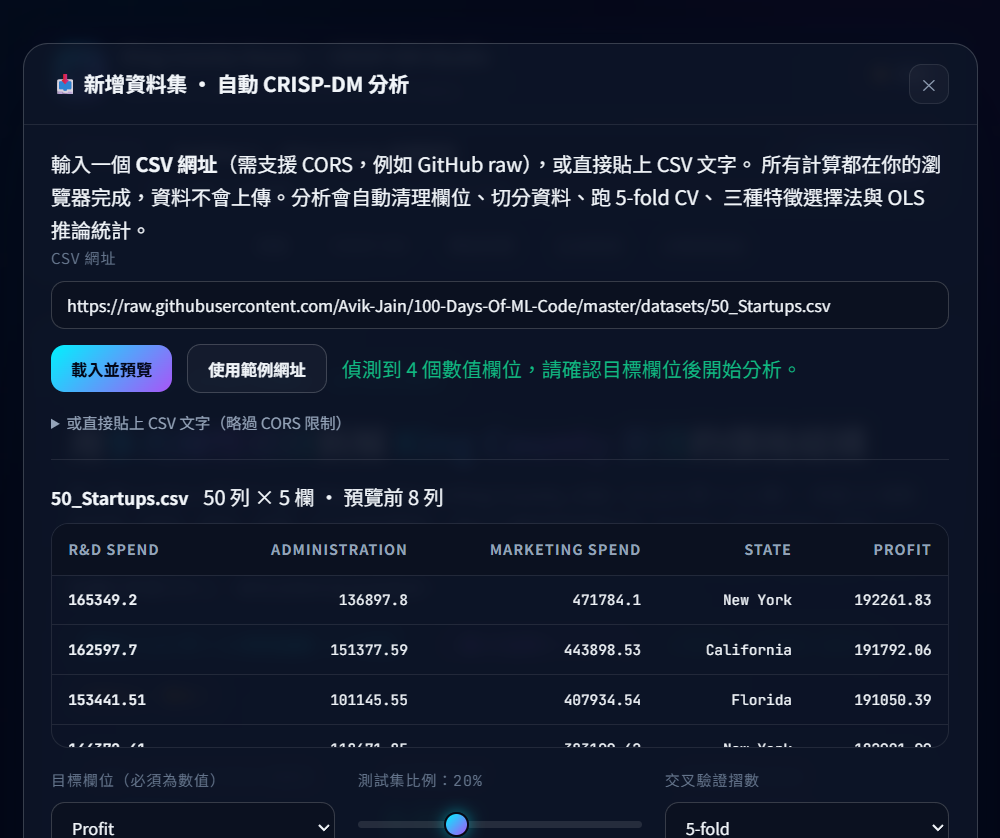

# CRISP-DM Multiple Linear Regression Studio

以 **CRISP-DM** 六階段流程打造的互動式多元線性迴歸平台（**scikit-learn** + **Flask** +
**Chart.js**），內建兩個 Kaggle 資料集，也可以載入任何 CSV 重跑整套分析。

🐙 GitHub Repository: https://github.com/w115056033/AIOT_HW2

🔗 Live Demo: https://w115056033.github.io/AIOT_HW2/

## ✨ 兩個重點功能

1. **🔀 下拉視窗切換兩種 Problem** — 導覽列最上方的 `PROBLEM` 下拉選單，切換後**整頁內容**
   （hero 指標、CRISP-DM 六階段敘述與數據表、模型探索器、互動預測器、診斷與原始資料）
   全部換成該資料集的版本；選擇會記在 URL（`#p=house`）與 `localStorage`。
2. **📥 可任意輸入 Dataset** — 點「**＋ 新增資料集**」可貼上 **任何 CSV 的網址**，
   或直接**貼上 CSV 文字**，瀏覽器端就會自動完成清理、One-Hot、切分、CV、特徵選擇、
   OLS 推論統計與診斷，並把結果加入下拉選單（詳見下方「🧪 任意資料集」章節）。


*網站首頁：最上方是 **Problem 下拉選單**與「**＋ 新增資料集**」按鈕，往下依序是 Hero 指標、
CRISP-DM 六階段、模型探索器、互動預測與診斷。*

📄 **專案紀錄 PDF**：[`docs/hw2_report.pdf`](docs/hw2_report.pdf) — 兩大主題：
**GPT 輔助內容**（本次完整對話紀錄）與 **NotebookLM 摘要**（House Prices 頂尖解法研究）。

---

## 📚 內建的兩個 Problem

| Problem | 資料集 | 規模 | 預測變數 | 特徵選擇法 | k 範圍 |
|---|---|---|---|---|---|
| **P1 · 50 Startups** | [50 Startups](https://www.kaggle.com/datasets/vinicius150987/startup-profit-prediction) | 50 筆 × 5 欄 | 5（含 State One-Hot） | Lasso、Forward SFS、RFE、ElasticNet、Exhaustive | 1–5 |
| **P2 · King County House** | [House Sales in King County, USA](https://www.kaggle.com/datasets/harlfoxem/housesalesprediction) | 21,613 筆 × 21 欄 | **16（> 13）** | Lasso、ElasticNet、RFE、Forward SFS、Backward (p-value) | 1–12 |

* 後端：**Flask**（REST API）＋ **scikit-learn / statsmodels** 預先計算的模型資料
* 前端：單一 `index.html` shell ＋ `static/app.js`（Chart.js 4、無框架、深／淺色主題）
* 部署：**GitHub Pages**（純靜態）或 **Vercel / 任何 Flask 主機**
* 選擇會記在 `localStorage` 與 URL（`#p=house`），重新整理後仍停在同一個 problem

---

## 📦 資料集來源

| Problem | 原始出處（Kaggle） | 專案內檔案 | 免登入下載（本專案實際使用的鏡像） | 規模 | MD5 |
|---|---|---|---|---|---|
| **P1 · 50 Startups** | [Startup Profit Prediction](https://www.kaggle.com/datasets/vinicius150987/startup-profit-prediction) | `50_Startups.csv` | [Avik-Jain/100-Days-Of-ML-Code · `50_Startups.csv`](https://raw.githubusercontent.com/Avik-Jain/100-Days-Of-ML-Code/master/datasets/50_Startups.csv) | 50 × 5 | `53DF90C164682CA0F0582873EAFD4D93` |
| **P2 · King County House** | [House Sales in King County, USA](https://www.kaggle.com/datasets/harlfoxem/housesalesprediction) | `kc_house_data.csv` | [ChengLi9/kc_house_data · `kc_house_data.csv`](https://raw.githubusercontent.com/ChengLi9/kc_house_data/HEAD/kc_house_data.csv) | 21,613 × 21 | `B1E7BDF4F3E61792C0979A5697DC7145` |

* **Kaggle 頁面是原始出處**；下載 Kaggle 版本需要登入帳號，所以本專案改用上表「免登入下載」
  的鏡像取得**相同內容**的 CSV，並把檔案直接附在 repo 根目錄，讓
  `build_model_data.py` / `build_house_data.py` 可一鍵重現（不需網路）。
* 可用 MD5 驗證檔案一致：`Get-FileHash -Algorithm MD5 50_Startups.csv kc_house_data.csv`（Windows PowerShell）、
  `md5sum 50_Startups.csv kc_house_data.csv`（Linux / macOS）。
* 欄位：P1 為 `R&D Spend, Administration, Marketing Spend, State, Profit`；
  P2 為 `id, date, price, bedrooms, bathrooms, sqft_living, sqft_lot, floors, waterfront,
  view, condition, grade, sqft_above, sqft_basement, yr_built, yr_renovated, zipcode,
  lat, long, sqft_living15, sqft_lot15`。
* 資料僅供課程作業與教學示範使用；P2 原始資料出自 King County（WA）開放資料，
  由 Kaggle 使用者 harlfoxem 整理上傳。

---

## 🌐 網站內容

| 區塊 | 說明 |
|---|---|
| **Problem 切換器** | 導覽列最上方的下拉選單，切換後 hero、CRISP-DM 六階段、模型探索器、預測器、診斷全部換成該資料集的內容與數據；旁邊的「＋ 新增資料集」可載入任意 CSV（見下節） |
| **Hero** | 資料集摘要、最強相關特徵、測試集最佳 R² / RMSE、CV 最佳 k、平均目標值、最終採用模型 |
| **CRISP-DM 六階段** | 可點選的 Stepper：業務理解 → 資料理解 → 資料準備 → 建模 → 評估 → 部署，每階段附實際數據表（敘述統計、相關係數矩陣、VIF、特徵排序、CV / 測試 RMSE 熱圖、逐步淘汰時間軸） |
| **模型探索器** | 切換方法與 k，即時更新 8 張指標卡、CV / R² 折線圖（含 k 游標）、迴歸方程式、係數推論表（β、SE、t、p、95% CI、VIF）、Top-10 殘差表與殘差散佈圖 |
| **互動預測器** | P1：3 個支出滑桿 + State 選單；P2：16 個屬性滑桿。即時計算預測值與「相對平均值的加減價」貢獻拆解（前端計算，Flask 在線時自動與後端 API 比對） |
| **診斷與結論** | Shapiro-Wilk、Breusch-Pagan、Durbin-Watson、VIF 檢定卡；各方法最佳子集總覽；可搜尋／排序／篩選的原始資料 |

---

## 🚀 本機執行

```bash
pip install -r requirements.txt

# 1) 需要時重新產生模型資料（可重現，random_state = 42）
python build_model_data.py      # -> model_data.json + static/data_startups.js
python build_house_data.py      # -> house_model_data.json + static/data_house.js

# 2) 啟動 Flask
python app.py
#    -> http://localhost:5000/
```

若只想看靜態版（模擬 GitHub Pages，沒有後端 API）：

```bash
python -m http.server 8080
#    -> http://127.0.0.1:8080/
```

前端優先讀取 `static/data_startups.js`（並在切換時 lazy-load `static/data_house.js`），
因此 `file://` 或純靜態主機也能完整運作；預測改由瀏覽器以 JSON 係數即時計算，
連不到 API 時徽章會顯示「○ 靜態模式（GitHub Pages）」。

---

## 🔌 Flask API

| Method | Endpoint | 說明 |
|---|---|---|
| GET | `/` | 互動儀表板（`index.html`，兩個 problem 共用） |
| GET | `/api/problems` | 可用的 problem 清單與其方法 |
| GET | `/api/models?problem=house` | 完整資料 `{meta, models}`；可加 `?algo=Lasso` 只取單一方法 |
| GET | `/api/summary?problem=house` | 每個（方法, k）評估結果的扁平清單 |
| POST | `/api/predict` | 以指定模型的係數即時推論（預設 problem = startups） |
| GET | `/api/dataset?url=...` | 伺服器端抓取 CSV（給沒有 CORS 標頭的來源用；分析仍在瀏覽器進行） |

P1（50 Startups，向後相容的舊欄位）：

```bash
curl -X POST http://localhost:5000/api/predict \
  -H "Content-Type: application/json" \
  -d '{"algo":"Lasso","k":2,"rd_spend":100000,"marketing_spend":150000,"admin_spend":120000,"state":"California"}'
```

P2（King County，使用 `problem` + `values`）：

```bash
curl -X POST http://localhost:5000/api/predict \
  -H "Content-Type: application/json" \
  -d '{"problem":"house","algo":"Forward SFS","k":8,
       "values":{"sqft_living":1910,"lat":47.57,"view":0,"grade":7,
                 "yr_built":1975,"waterfront":0,"bedrooms":3,"bathrooms":2.25}}'
```

```json
{
  "status": "success",
  "problem": "house",
  "algorithm": "Forward SFS",
  "k": 8,
  "features": ["sqft_living", "lat", "view", "grade", "yr_built", "waterfront", "bedrooms", "bathrooms"],
  "prediction": 439922.82,
  "target": "price",
  "rmse": 216929.14,
  "r2": 0.6887,
  "breakdown": [
    { "feature": "Intercept (β₀)", "value": 1, "coef": -20874549.07, "contribution": -20874549.07 }
  ]
}
```

> `breakdown` 為原始單位的 β·x（加總即 prediction）；網站上的「貢獻拆解」改用
> **β·(x − 平均)**，因此可以和「基準（平均特徵值）」一起解讀為加減價。

---

## 🧪 任意資料集（Add any dataset）

導覽列的「**＋ 新增資料集**」可以對任何 CSV 重跑一次完整的 CRISP-DM：

1. 貼上 **CSV 網址**（需支援 CORS，例如 GitHub raw、gist），或直接**貼上 CSV 文字**（完全繞過 CORS）
   * 範例網址（可直接貼上試玩）：
     `https://raw.githubusercontent.com/Avik-Jain/100-Days-Of-ML-Code/master/datasets/50_Startups.csv`
2. 自動預覽前 8 列、列出可用的數值欄位，選好**目標欄位**
3. 可調整測試集比例、CV 摺數、最大特徵數 k
4. 按「開始分析」，瀏覽器端即時完成：
   欄位清理 → 缺失值補值 → One-Hot → 80/20 切分 → 5-fold CV →
   **3 種特徵選擇法**（Correlation / Forward SFS / RFE）× k → OLS 推論統計（β、SE、t、p、95% CI、VIF）→ 診斷
5. 完成後自動加入上方下拉選單，整個頁面切成這份資料集的 hero / 六階段 / 圖表 / 預測器 / 診斷

整條管線在 **`static/analyze.js`**（純前端，無需後端），所以 GitHub Pages 版本也能用；
OLS 以正規方程式求解（對角預條件 + 高斯消去），CV 與測試指標由充份統計量
（`X'X`、`X'y`、`y'y`）直接計算，21,000 列 × 18 特徵約 1.5 秒完成。

自動處理規則：

| 情況 | 處理方式 |
|---|---|
| 欄位名為 `id` / `index` / `*_id` | 視為流水號，移除 |
| 日期欄位（`2014-10-13`、`20141013T000000`） | 移除（不建立時間趨勢） |
| 類別欄位 ≤ 12 個水準 | One-Hot，第一個水準為參考類別（預測器變成下拉選單） |
| 類別欄位 > 12 個水準 | 移除，並在 Phase 2 的「移除欄位」中列出原因 |
| 完全線性相依的欄位（例：`sqft_living = sqft_above + sqft_basement`） | 依 \|r\| 排序後自動移除多餘欄位，避免 `X'X` 奇異 |
| 缺失值 | 數值以中位數、類別以眾數補值（Phase 2 顯示補值數量） |
| 列數 > 60,000 / 編碼特徵 > 24 | 固定種子隨機抽樣 / 依 \|r\| 截斷 |

限制（刻意寫在 UI 上）：

- 自訂資料集**只存在本次瀏覽階段**，重新整理後消失（重新載入同一網址結果相同，因為隨機種子固定）
- 常態性檢定用 **Jarque-Bera**（不是 Shapiro-Wilk），因為純前端沒有 Shapiro 的實作
- 自訂資料集**不經過後端 API**（Flask 只提供 `/api/dataset` 代理下載）



---

## 📊 Problem 1 · 50 Startups

### 1. R&D Spend 主導了一切

| 模型 | 測試集 RMSE | 測試集 R² | CV RMSE |
| :--- | ---: | ---: | ---: |
| **OLS（僅 R&D Spend，k=1）** | **$7,714** | **0.9265** | $9,407 ± 3,224 |
| Baseline OLS（全 5 特徵） | $9,056 | 0.8987 | $9,551 |
| 最佳 k=3（R&D + Admin + Marketing） | $8,996 | 0.9001 | $9,105 ± 2,992 |

* `R&D Spend` 與 `Profit` 的 Pearson r = **0.973**，單一變數即解釋 **94.65%** 的變異。
* 5 種特徵選擇法幾乎收斂到同一組答案；`Administration`、`Marketing Spend`、`State`
  的 p 值皆 > 0.05（逐步淘汰後只剩 `R&D Spend`，p < 0.001）。
* 部署模型：`Profit ≈ 49,033 + 0.854 × R&D Spend`（以全部 50 筆重新擬合，
  存於 `startup_profit_model.joblib`）。

### 2. CV 與 Hold-out 的張力（刻意保留的教學點）

* **CV 偏好** k=3（RMSE $9,105），**測試集偏好** k=1（RMSE $7,714）。
* CV RMSE 的雜訊帶是 **± $3,055** —— 遠大於模型之間的差距，兩者在統計上無法區分。
* 依奧坎剃刀原則與可解釋性，最終採用單變數模型；網站同時呈現兩種視角。

### 3. 迴歸假設檢定（以 R&D-only 模型計算）

| 檢定 | 統計量 | 判定 |
| :--- | ---: | :--- |
| Shapiro-Wilk（殘差常態） | 0.918（p = 0.0069） | 輕微偏離（單一高利潤新創） |
| Breusch-Pagan（同變異數） | 1.625（p = 0.2025） | 通過 |
| Durbin-Watson（獨立性） | 1.880 | 通過 |
| Max VIF（共線性） | 1.000 | 通過 |

---

## 🏠 Problem 2 · King County House（16 個特徵）

### 1. 資料準備的關鍵決定

* 移除 `id`（流水號）、`date`（交易日期，模型不含時間趨勢）。
* 移除 **`sqft_basement`**：因為 `sqft_above + sqft_basement ≡ sqft_living`，
  三欄同時進入 OLS 會造成**完全共線**（設計矩陣奇異）。
* `zipcode` 有 70 個類別 → 改用 `lat` / `long` 兩個連續變數表達地理位置。
* 剩 **16 個數值特徵**：`bedrooms, bathrooms, sqft_living, sqft_lot, floors, waterfront,
  view, condition, grade, sqft_above, yr_built, yr_renovated, lat, long, sqft_living15, sqft_lot15`。
* 80/20 切分（訓練 17,290／測試 4,323）、5-fold CV；Lasso / ElasticNet / RFE 前做
  `StandardScaler`，最終 OLS 與推論統計仍用原始單位。

### 2. 模型比較

| 模型 | 特徵數 | 測試集 RMSE | 測試集 R² | CV RMSE |
| :--- | ---: | ---: | ---: | ---: |
| 單變數（`sqft_living`） | 1 | $276,559 | 0.4941 | $257,553 |
| **Forward SFS（最終採用）** | **8** | **$216,929** | **0.6887** | $201,510 ± 12,795 |
| 測試集 / CV 最佳（Lasso / Backward） | 12 | $214,826 | 0.6947 | $200,296 |
| Baseline OLS（全部特徵） | 16 | $214,473 | 0.6957 | $200,101 |

* `sqft_living`（r = 0.702）、`grade`（0.667）、`sqft_above`（0.606）是最強的三個訊號。
* **報酬遞減**：k 從 1 → 8，CV RMSE 由 $257,553 降到 $201,510；但 k = 8 → 12 只再改善
  不到 1%，完全落在 **± $13,684** 的 CV 雜訊帶內。最終以 **8 個特徵** 交付，用一半的
  特徵換取精簡與抗共線性。
* 係數解讀（全模型）：`sqft_living ≈ $145/ft²`、`grade` 每升一級 ≈ $95.7k、
  `waterfront` ≈ +$568k；`bedrooms` 為負（面積固定下切出更多房間反而降低單價）。

### 3. 迴歸假設檢定（如實呈現線性模型的極限）

| 檢定 | 統計量 | 判定 |
| :--- | ---: | :--- |
| Shapiro-Wilk（殘差常態） | 0.743（p ≈ 1.9e-66） | 未通過（右偏 + 大樣本） |
| Breusch-Pagan（同變異數） | 2096.3（p < 0.001） | 未通過（異質變異數） |
| Durbin-Watson（獨立性） | 1.995 | 通過 |
| Max VIF（共線性） | 8.633 | 通過（< 10） |

* 房價明顯右偏（平均 $540k、中位數 $450k、最高 $7.7M），變異數隨價格放大。
* OLS 的點估計仍可用，但**推論需改用穩健標準誤**；下一步建議對 `log(price)` 建模、
  以 zipcode 目標編碼取代經緯度、並以 LightGBM / XGBoost 作為非線性基準。

---

## 📁 專案結構

```text
├── index.html                    # 前端 shell（唯一的 HTML，兩個 problem 共用）
├── static/
│   ├── site.css                  # 共用樣式（深／淺色主題、problem 切換器）
│   ├── app.js                    # 共用前端引擎（config 驅動的渲染器、預測、API 比對）
│   ├── analyze.js                # 瀏覽器端 CRISP-DM 引擎（任意 CSV → OLS + 推論統計）
│   ├── dataset.js                # 「新增資料集」對話框（URL / 貼上 CSV）
│   ├── problems.js               # 兩個 problem 的文案／設定（{{token}} 由 meta 填入）
│   ├── data_startups.js          # window.PROBLEM_DATA.startups（靜態模式用）
│   ├── data_house.js             # window.PROBLEM_DATA.house（切換時 lazy-load）
│   └── model_data.js             # window.MODEL_DATA（向後相容的 P1 資料）
├── model_data.json               # P1 完整資料（Flask API 用）
├── house_model_data.json         # P2 完整資料（Flask API 用）
├── build_model_data.py           # P1 可重現腳本（5 方法 × k=1…5）
├── build_house_data.py           # P2 可重現腳本（5 方法 × k=1…12）
├── app.py                        # Flask 應用與 REST API（支援 ?problem=）
├── api/index.py                  # Vercel serverless 進入點
├── vercel.json                   # Vercel rewrite 設定
├── requirements.txt
├── 5115056033_hw2.ipynb          # P1 完整分析筆記本（已執行，含圖表）
├── 50_Startups.csv               # P1 資料集
├── startup_profit_model.joblib   # P1 最終 Pipeline（前處理 + 模型）
├── kc_house_data.csv             # P2 原始資料（21,613 × 21）
├── docs/
│   ├── site.png                  # 首頁截圖（README 封面）
│   └── any-dataset.png           # 「新增資料集」對話框截圖
└── .github/workflows/static.yml  # GitHub Pages 自動部署
```

---

## ☁️ 部署

### GitHub Pages（靜態，最簡單）

1. 建立 repo（例如 `week6`），把本資料夾推上 `main`。
2. **Settings → Pages → Build and deployment → Source: GitHub Actions**。
3. `static.yml` 會自動發佈整份靜態內容到 `https://<你的帳號>.github.io/<repo>/`。

> 沒有後端時徽章顯示「○ 靜態模式（GitHub Pages）」，所有互動（切換 problem、切換模型、
> 預測、圖表）仍可運作，因為兩份資料都已內嵌為 `static/data_*.js`。

### Vercel（含 API）

匯入 repo 即可，`vercel.json` 會把請求導到 `api/index.py`（Flask WSGI app）。

### 其他主機

任何能跑 Flask 的環境：`gunicorn app:app`（Linux）或 `waitress-serve app:app`（Windows）。

---

## 🔁 可重現性

| 腳本 | 內容 |
|---|---|
| `build_model_data.py` | P1：One-Hot `State`（加州為參考類別）→ 5 特徵；80/20 + 5-fold；Lasso / Forward SFS / RFE / ElasticNet / Exhaustive；每個子集以 statsmodels OLS 產生 β、SE、t、p、95% CI、F、VIF |
| `build_house_data.py` | P2：清洗（移除 id / date / zipcode / sqft_basement）→ 16 特徵；80/20 + 5-fold；Lasso / ElasticNet / RFE / Forward SFS / Backward；k = 1…12 全部重算 CV RMSE；含 Shapiro / Breusch-Pagan / Durbin-Watson / VIF |

* 兩個腳本都在 `random_state = 42` 下可完全重現，輸出 `*.json` 與 `static/data_*.js`。
* 前端只透過 `{{token}}` 取用 `meta` 裡的數字，因此文案與數據不會各自漂移。

---

## 🙏 參考

* 版面靈感：[StatsUnlock — Multiple Linear Regression Calculator](https://statsunlock.com/multiple-linear-regression-calculator/)
* 資料集：P1 [50 Startups (Kaggle)](https://www.kaggle.com/datasets/vinicius150987/startup-profit-prediction)；
  P2 [House Sales in King County, USA (Kaggle)](https://www.kaggle.com/datasets/harlfoxem/housesalesprediction)
* 套件：[scikit-learn](https://scikit-learn.org/)、[statsmodels](https://www.statsmodels.org/)、
  [Flask](https://flask.palletsprojects.com/)、[Chart.js](https://www.chartjs.org/)
